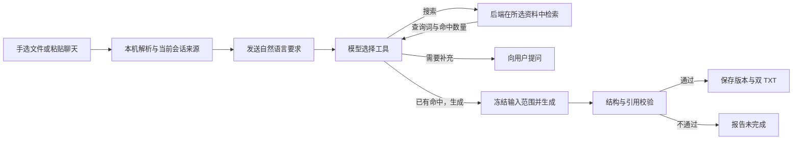

# 记言 · Minutes

把值得留下的聊天，整理成以后用得上的内容。

记言是一个中文、本地优先的个人资料整理 Agent，运行在 macOS 浏览器中。手动选择聊天文件或截图，也可以直接粘贴聊天，再用一句话说明想整理什么。系统在所选资料中检索、生成内容，最后交付两份文件：**整理内容.txt** 用来阅读，**核查参考.txt** 用来回看出处。继续对话可以调整要求，并保留前几轮的成果。

## 为什么做这个项目

我平时有整理聊天记录的需要。对我来说，难点不只是把聊天保存下来，而是从零散表达中找到某个主题，整理后还能分清：哪些是已有经验，哪些只是建议，哪些问题还没有结论。

我希望把「找材料、定主题、整理、回看依据」接成一个完整任务。最初的版本需要按步骤操作，后来根据自己的使用反馈，改成了现在的对话入口：用户决定处理哪些资料、想得到什么，系统完成中间步骤，遇到不能继续的情况再停下来。

这是个人项目，我负责需求整理、AI 辅助开发、测试验收和边界设置，目前没有团队成员或其他试用者参与。代码实现和测试过程中使用了 AI 编码工具，项目还没有经过正式用户研究或规模化使用验证。

- [产品案例：需求怎么变成规则和验收](docs/product-case-study.md)
- [3 分钟演示说明](docs/interview-demo.md) · [可直接导入的合成聊天](examples/interview/chat-demo.txt)
- [最近一次完整工程回归记录（2026-10-23）](docs/streamlined-agent-verification-2026-10-23.md)

## 怎样使用

1. 新建对话，通过底部「＋」手动选择资料，或把聊天记录粘贴进输入框。选好后直接导入有效内容，不反复确认；无法确定的截图文字需要校对。
2. 输入要求，例如「把这段创业讨论整理成可以执行的事项，保留分歧和未确定的部分」。
3. 等待整理，必要时回答补充问题，也可以随时停止。完成后直接阅读正文，分别下载整理内容和核查参考。
4. 继续说「再简短一点，只保留下一步行动」，生成下一版。旧成果仍可查看和下载。

选择文件只是同意本机导入；**发送整理要求才授权本轮 AI 处理所选资料**。普通路径不需要手动填关键词、挑工具或逐次点击授权卡。

支持 TXT、JSON、JSONL、CSV、XLSX、受支持的单文件 ZIP，以及 PNG/JPG/JPEG 截图。普通 TXT 无法解析为聊天时，可按完整文字导入；截图通过本机 macOS Vision 识别。文件部分解析成功时，仅导入有效记录，导入／跳过数量可在文件名提示中查看；空内容不能提交。聊天格式与 OCR 都有适用范围，不能把「支持文件格式」等同于「适配所有来源导出格式」。

## 三个影响最大的产品取舍

| 遇到的问题 | 当前处理 | 保留的控制 |
| --- | --- | --- |
| 用户希望说完要求就完成任务，旧流程仍要逐步填表 | 用对话提交目标，由模型选择下一步工具 | 后端只开放搜索、生成和提问，不允许任意执行代码或读取文件 |
| 文件是用户自己选的，却还要反复确认 | 选择后直接处理，发送要求授权本轮整理 | 授权只绑定当前会话、任务和来源；停止、换来源、新任务或重启后失效 |
| 正文里的证据编号打断阅读，但结果又需要核查 | 整理正文与参考文件分开 | 两份文件指向同一保留版本，引用仍在后台核验 |

这些取舍改变了交互和任务调度；生成阶段继续沿用现有 v10 总结规则。详细讨论见[产品案例](docs/product-case-study.md)。

## Agent 怎样完成任务



当前是一个有调用边界的工具循环。模型返回结构化工具选择，后端校验参数并执行；控制模型根据查询词和命中数量等元数据决定下一步，资料正文在生成阶段进入模型请求。

检索采用所选聊天／笔记范围内的关键词字面匹配，没有接入向量数据库。它容易解释和定位，但可能漏掉没有共同用词的相关表达。这里需要分别评估「资料是否找全」和「找到后是否整理准确」。

| 层次 | 实现与职责 |
| --- | --- |
| 交互 | React、TypeScript、Vite；附件、会话切换、任务状态与结果下载 |
| API 与任务控制 | Python、FastAPI、Pydantic；接口校验、工具白名单、任务与来源检查 |
| 本地存储 | SQLite；导入快照、会话状态、文档与版本。已有全文索引用于其他搜索路径，主对话使用混合资料字面检索 |
| 模型与校验 | DeepSeek Provider；生成后由本地代码检查结构、引用标识和原文一致性 |
| 验证 | pytest、Vitest、Playwright；覆盖服务、接口、交互与浏览器完整流程 |

实现入口和测试对应关系见[代码阅读索引](docs/product-case-study.md#代码阅读索引)。

## 哪些事由程序控制

- **资料范围**：只处理用户选择或粘贴的资料；每次动作检查来源归属和有效期。不会自动搜索本机文件、登录微信／QQ或读取其数据库。
- **调用范围**：每轮最多 4 次工具决策调用、3 次本地检索。正文生成另有分块调用预算，并与决策调用共用每日请求上限；4 次不等于整个任务最多调用模型 4 次。
- **停止与恢复**：取消后的晚响应不能继续覆盖当前任务；打开旧历史不会触发新调用。停止不能撤回供应商已经收到的请求，仍可能产生费用。
- **结果范围**：没有命中资料不能直接生成；引用必须属于所选范围。引用核验通过不等于总结语义一定正确，最终内容仍需要人工判断。
- **数据期限**：独立原文自导入起保留 7 天，可提前删除；已有文档版本继续保留。原文清理后，参考下载不再提供对应摘录。平台无法撤回用户已经下载或备份的副本。

「本地优先」指解析、检索、存储等在本机完成，AI 决策和生成会调用已配置的外部模型。SQLite 默认未加密，脱敏也不能保证覆盖所有个人信息。详见[隐私与清理](docs/privacy-and-cleanup.md)。

## 当前进展与限制

已具备手选资料、自然语言任务、工具调用、连续整理和双文件下载的完整链路。2026-10-23 的完整工程回归记录为：后端 1,137 项通过，前端 326 项通过，浏览器端到端 32 项通过；跳过项与测试范围见[原始记录](docs/streamlined-agent-verification-2026-10-23.md)。这些测试使用合成资料及测试 Provider，证明对应工程场景，不代表真实模型内容质量。

当前还有几项明确限制：

- 真实 QQ／微信导出尚未完成验收，直接连接来源处于阻塞状态，现阶段以用户提供的文件为入口。
- 历史真实模型调测使用过后来撤回的写作规则；当前 v10 尚未完成新的跨领域质量验收，详见[调测记录](docs/real-model-work-smoke-test.md)。
- 每轮完整累计要求限 512 字，超限要求简化后新建对话；主对话搜索的来源单元总数上限为 2,000，超限会拒绝，不静默截断。
- 当前是本机单用户应用，会话恢复受浏览器会话范围限制。文档保存不设期限不等于可以跨浏览器、跨设备找回，应下载持有重要成果。
- 没有录音转写、企业权限体系或向量知识库；后续是否增加，先看实际场景和验证结果。

## 本机运行

要求：macOS Apple Silicon、Python 3.11+、Node.js 24.x 与 corepack。

```sh
./scripts/bootstrap_macos.sh
./scripts/start_macos.sh
```

初始化脚本安装锁定依赖、编译本机 OCR 工具并构建前端，需要 macOS 命令行开发工具。脚本会展示数据／导出位置并要求确认，已有配置不覆盖，SQLite 通过迁移升级。默认目录沿用历史内部名称：

- 数据：`~/Library/Application Support/Chat to How-To`
- 导出：`~/Documents/Chat to How-To Exports`

应用地址为 [http://127.0.0.1:8765](http://127.0.0.1:8765)，单个 FastAPI 进程提供前端和 API，只监听回环地址。停止用 `./scripts/stop_macos.sh`；启动时加 `--no-open` 可不自动打开浏览器。

AI 整理需要在本机私密配置 `DEEPSEEK_API_KEY`，不要将密钥写入仓库或聊天。运行配置默认使用 `deepseek-v4-flash`，可按[API 配置指南](docs/api-setup.md)设置。没有模型配置时，已有文档查看、下载等本地能力仍可使用。

自定义路径：

```sh
./scripts/bootstrap_macos.sh --data-dir "/absolute/private/data" --export-root "/absolute/approved/exports"
export CHAT_TO_HOWTO_CONFIG="/absolute/private/data/runtime-config.json"
./scripts/start_macos.sh
```

旧手动筛选、逐次授权、人工编辑与 Markdown／DOCX 导出保留在「设置与高级工具」。历史逐按钮说明见[系统工作原理](docs/how-it-works.md)，不与当前主对话的操作要求混用。

## 开发与验证

```sh
make test PYTHON=backend/.venv/bin/python
cd frontend
corepack pnpm test
corepack pnpm run typecheck
corepack pnpm run build
corepack pnpm run test:e2e
```

端到端测试使用私有临时目录、合成适配器和不联网的测试 Provider，测试服务器禁止外连。完整回归记录与真实模型评估分别记录，避免把接口测试通过当作内容可用。

启动失败可检查私有数据目录中的 `server.log`；构建缺失可重新运行安装脚本。模型认证、限流或超时问题见[API 配置指南](docs/api-setup.md)。来源接入的历史调查和受阻原因见[来源配置](docs/source-setup.md)，无需为运行本项目扩大系统权限。
