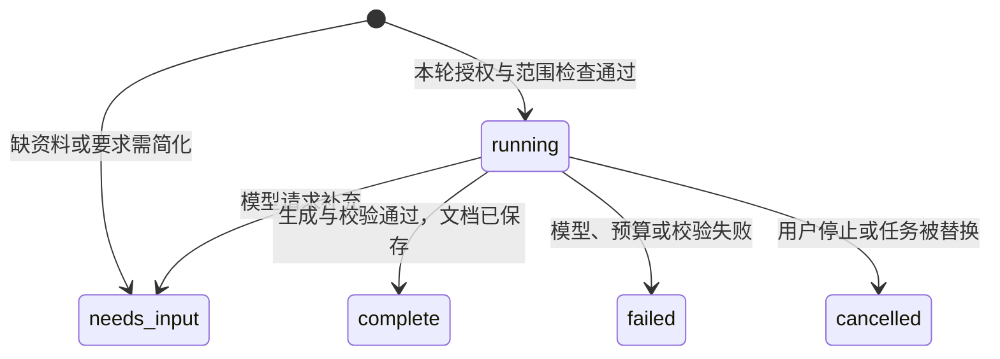

# 记言 · Minutes：从聊天整理需求到对话式工具

这是一个源于我自己使用需要的个人项目。我负责需求整理、AI 辅助开发、测试验收和边界设置，没有团队成员或其他试用者参与。本文回顾已经发生的需求和迭代，也把仍未验证的部分单独写清楚。

## 我想解决的具体问题

我平时需要整理聊天记录。有用的内容常常分散在不同段落里，夹着闲聊、追问和后续修正。复制到文档以后，仍然要重新找主题、合并表达，并判断一句话到底是经验、建议，还是尚未确定的想法。

所以我给记言设定的任务是：用户提供资料，说明这次想整理什么，系统交付一份能直接阅读的结果，并留下可核查的出处。范围先落在个人资料整理，暂不扩展到企业知识库、多人协作或直接接管聊天软件。

当前产品使用网页作为本机操作界面。是不是 Agent，主要看任务如何执行：模型是否根据工具返回决定下一步，程序是否能把检索、生成和交付接起来。仅把表单换成聊天气泡，并不能满足我最初的要求。

## 我的工作与 AI 的分工

| 工作 | 我的参与 | AI 辅助的部分 |
| --- | --- | --- |
| 需求整理 | 提出自己的使用场景，明确文件输入、自然语言要求和双文档输出 | 整理需求说明，映射现有功能与待改动部分 |
| 交互迭代 | 指出旧表单、重复确认、证据干扰阅读等问题，确认修改方向 | 修改页面和任务流程，补充实现说明 |
| 开发 | 使用 AI 编码工具推进实现，核对功能是否符合要求 | 编写和调整代码，定位问题，编写及执行自动化测试 |
| 测试验收 | 在实际页面发现问题，用截图和具体操作反馈，复查修改结果 | 回归测试、异常场景检查、独立代码复核 |
| 边界设置 | 明确只处理手选资料，规定何时授权、何时停止、正文和依据如何呈现 | 把规则落实到接口校验、任务状态、来源检查和导出逻辑 |

这些是目前能够说明的个人贡献。我没有把 AI 生成的代码表述为自己逐行独立编写，也没有把个人体验反馈当成正式用户访谈。原型工具作品、外部试用数据和业务效果数据目前都不是这个项目已有的成果。

## 三次值得讲清楚的迭代

### 1. 从按步骤操作，改成说完要求后执行

旧页面把添加资料、填写要求、修改内容、预览下载分成几个步骤。我提出要做对话式智能体后，重点不是让界面看起来像聊天，而是让系统接过中间的操作。

现在用户只需要给出资料和要求，模型可以选择检索、生成或者提问；检索结果返回后，再决定下一步。用户还能继续说「只保留某个主题」「再简短一些」，生成下一版成果。

这里保留了一个限制：多轮用户要求会完整累计，超过当前 512 字预算时要求简化后新建对话，而不是悄悄删掉前面的条件。它目前不适合长时间、开放式的助理对话；这是后续需要评估的使用限制。

### 2. 减少重复确认，但把授权限定到这一轮

我在使用时反复遇到确认步骤：文件已经由我选好，仍要预览、勾选，再确认。后来我明确要求「用户手选，选好后默认正确」，不需要每一步都重新表态。

处理方式分成两个时刻：选择或粘贴资料，同意本机导入；发送整理要求，同意本轮使用所选资料调用 AI。正常流程直接推进，无法确定的 OCR 内容仍需校对，没有有效内容则不能空提交。

减少确认后，控制责任落到了后端：任务必须绑定会话、来源和本轮标识。停止、换来源、新任务或重启后，旧权限不能继续使用；查看历史也不能自动触发新请求。主对话和保留的高级手动工具走不同授权交互，不能用一套旧文案解释两者。

还有一个没有因为交互简化而消失的风险：部分解析失败的记录会被跳过。现在计数放在文件名提示里，界面更轻，但不如单独确认醒目。后续真实试用需要检查用户是否能意识到资料有遗漏，而不是直接认定这项取舍已经得到验证。

### 3. 正文负责阅读，参考负责核查

我希望最后看到的是整理结果，正文里密集的证据编号会影响阅读；但去掉核查能力，又很难判断某条结论从哪里来。

因此输出拆成两份 TXT。整理内容只保留实质正文，核查参考保留来源定位、摘录和版本说明。两份文件绑定同一个保留版本，后续修改形成新成果，不覆盖前一轮。后台的引用校验仍然执行。

分开呈现也有代价：核查多了一次打开参考文件的动作。适合日常阅读，不代表用户可以完全不核对结果。原文被清理以后，参考文件不再提供相应摘录，已经生成的正文继续保留。

## 把反馈写成可检查的需求

下面是根据真实迭代记录补做的需求追踪表，不是事先存在的团队排期。P0 表示影响当前核心使用或边界，P1 表示下一步验证与改进。

| 编号／优先级 | 需求来源 | 规则与验收条件 | 当前状态 |
| --- | --- | --- | --- |
| R01／P0 | 「对话后自动完成任务」 | 有资料和有效要求时进入工具循环，满足检索、生成与校验条件才交付成果；条件不足时不能假装完成 | 已实现，有合成端到端覆盖 |
| R02／P0 | 「文件手选，选好后默认正确」 | 只处理选择的文件；正常导入无重复确认；空内容拒绝，OCR 不确定时校对 | 已实现，导入与异常交互有测试 |
| R03／P0 | 「取消粘贴笔记，输入框识别聊天」 | 主框能识别受支持的聊天格式；普通多行整理要求仍按消息发送 | 已实现，不声称识别所有格式 |
| R04／P0 | 「正文只给最后结果」 | 正文不注入系统证据编号，参考单独下载，两者对应同一版本 | 已实现，版本与清理边界有测试 |
| R05／P0 | 用户控制整理范围 | 停止、改来源后旧任务不可继续；无命中资料不能直接生成；不能跨会话使用资料 | 已实现，有服务和接口测试 |
| R06／P1 | 个人自测不足以说明普遍可用 | 对当前模型与 Prompt 做内容质量评估，观察跳过记录提示是否足够清楚 | 待验证，没有外部试用结果 |

## 技术怎样承接产品规则

### 让模型选工具，让程序决定能不能执行

控制模型输出结构化 JSON。例如下面是符合接口约定的示例，不是一次真实运行记录：

```json
{
  "tool": "search_sources",
  "arguments": {
    "terms": ["创业", "访谈"],
    "summary_type": "ideas",
    "goal": "整理创业讨论中的想法和待验证事项"
  }
}
```

后端只接受 `search_sources`、`generate_document`、`ask_user`。字段、长度和枚举都需要验证，模型不能用额外字段获得任意代码执行或文件访问能力。`goal` 是工具参数中的整理目标描述，生成仍保留用户完整累计要求；不能让模型提炼的短目标替代原要求。

主对话请求携带 `text`、`client_message_id` 和 `automatic`。前端负责发送用户意图，后端负责校验和任务生命周期；重复的消息标识不会新建同一任务。这类字段约定让「不要重复执行」「旧响应不能覆盖新任务」成为可验证规则。

### 检索选择了可解释的实现，也接受它的不足

当前主对话调用 `MixedSearchService`。它先验证所有来源的归属与有效性，再对消息／段落做关键词字面匹配；多个词是「任一个命中即可」，不是向量相似度检索。来源单元总数超过 2,000 时拒绝，不会只取前面一部分却声称处理了全部。

检索工具把查询词、命中数等元数据交回控制模型，不把资料摘录交给它做语义重排。生成阶段才使用选定命中范围的脱敏正文。因此当前主要问题之一是召回：同义表达可能漏掉，命中数量多也未必意味着内容相关。后续应先用标注样本测漏检和误检，再决定是否值得增加语义检索。

自然语言里的时间要求目前也不会自动转换成检索接口的硬时间过滤条件，主对话默认包含未标时间的内容。不能承诺输入「只看上周」就已在数据层严格排除了其他时间；演示选择已经确定范围的资料，后续再评估这类筛选能力。

### 任务不是一直「生成中」

主对话对外状态可以概括为：



用户回答补充问题会发起新一轮任务。内部兼容旧高级工具的 `waiting_approval` 状态；主对话自动任务把这段内部状态呈现为运行中，避免页面停在没人需要点击的确认步骤。

最多 4 次的是控制模型调用，最多 3 次的是本地搜索。正文生成还有自己的分块和汇总预算，当前入口允许的生成调用预算上限为 20，并与控制调用共用每日请求限制。这些是上限，不是一次任务固定会发生的调用数，也不能据此直接估算账单。达到边界会停止，无法收回已经发送给模型供应商的请求。

### 对结果的控制不止发生在提示词里

生成结果要经过结构校验和本地引用检查。引用标识必须存在于允许范围内，引文必须与本地保存的来源一致；校验失败不能按正常结果交付。文档保存后，两份 TXT 用同一组 `document_id`、`version_id` 读取。

这个检查能挡住不存在的引用、越界引用和改写的引文，却不能证明模型正确理解了因果、条件或分歧。比如引文是真的，模型仍可能把「准备尝试」概括成「已经验证有效」。所以工程校验与语义验收需要分开。

## 边界与代价

| 边界 | 当前控制 | 仍需知道的限制 |
| --- | --- | --- |
| 输入范围 | 手选文件／粘贴；归属检查；格式、数量与正文限制 | 不能适配所有真实聊天导出；不接管微信／QQ |
| 模型执行 | 工具白名单、严格参数、次数与每日预算、当前轮授权 | 模型可能选错词、问得不够好；调用限制不解决所有质量问题 |
| 取消与并发 | 本轮标识、取消令牌、会话 revision 检查；晚响应不能覆盖新结果 | 取消前已发出的请求可能产生费用 |
| 数据保存 | 独立原文 7 天清理，成果版本继续保留 | 默认数据库未加密；不能撤回下载、系统备份或同步副本 |
| 本地与联网 | 解析、检索和存储在本机；决策、生成使用外部模型 | 本地优先不等于完全离线，脱敏不是匿名保证 |
| 版本与查证 | 双 TXT 同版；原文清理后不再下载旧摘录 | 保留成果仍可能包含原资料信息；证据检查不替代人工判断 |

## 我如何判断这一版是否可用

开发过程中，我用实际页面反馈交互问题，例如粘贴笔记后露出旧页面、反复确认、正文证据过多、消息位置与头像冗余。修正之后，再用对应场景复查。自动化测试则覆盖难以靠一次点击发现的问题，例如取消后的晚响应、重复请求、切换会话、旧版本下载和原文清理。

[2026-10-23 工程回归记录](streamlined-agent-verification-2026-10-23.md)列出了后端、前端与浏览器测试结果。这些使用合成资料及测试 Provider；不能证明某个真实模型在求职、创业、学习等主题下都能可靠整理。历史真实模型调测使用过后来撤回的规则，不能直接给当前 v10 背书。

下一步内容验收准备按以下场景展开，**以下是评估方案，尚无实测结果**：

| 场景 | 人工先标注什么 | 看输出时检查什么 |
| --- | --- | --- |
| 主题穿插闲聊 | 应选／不应选的消息 | 有没有漏掉关键内容或混入无关段落 |
| 同义表达 | 没用同一关键词但相关的消息 | 字面检索漏掉多少，换词能否补回 |
| 多人分歧 | 两种观点及各自条件 | 有没有把分歧合成一个确定结论 |
| 后续更正 | 最终有效的说法与被撤回内容 | 是否仍沿用旧结论 |
| 提议与未定事项 | 已完成、准备做、待决定的分别有哪些 | 是否把计划写成事实、补出未经讨论的步骤 |
| 没有相关资料 | 资料中不支持的要求 | 能否停下、询问或说明失败，而不是交付无依据结果 |

评估记录需要包含输入范围、模型与 Prompt 版本、缓存状态、实际调用数、耗时和逐项人工判断。同一批样本才能比较修改前后。若出现改变结论的事实错误、状态误判或关键条件缺失，该样本应判不通过；「可用结果比例」只在实际人工验收后计算。目前不填写节省时间、正确率或满意度数字。

## 代码阅读索引

不用从整个仓库开始读，可以按一个用户任务往下看：

| 要核对的产品规则 | 实现入口 | 测试证据 |
| --- | --- | --- |
| 选文件、聊天粘贴、异常校对 | [ConversationWorkspace](../frontend/src/features/conversation/ConversationWorkspace.tsx)、[composerChat](../frontend/src/features/conversation/composerChat.ts) | [交互测试](../frontend/src/features/conversation/ConversationWorkspace.test.tsx)、[粘贴识别测试](../frontend/src/features/conversation/composerChat.test.ts) |
| 工具循环、次数、任务撤销 | [ConversationAgentService](../backend/src/chat_to_howto/services/conversation_agent.py) | [任务与授权测试](../backend/tests/services/test_conversation_agent.py) |
| 请求字段与接口边界 | [会话 API](../backend/src/chat_to_howto/api/agent_conversations.py)、[会话仓库](../backend/src/chat_to_howto/repositories/agent_conversations.py) | [API 测试](../backend/tests/api/test_agent_conversations.py)、[存储测试](../backend/tests/repositories/test_agent_conversations.py) |
| 所选来源内检索 | [MixedSearchService](../backend/src/chat_to_howto/services/mixed_search.py) | [混合检索测试](../backend/tests/services/test_mixed_search.py) |
| 引用是否真实且在范围内 | [EvidenceValidator](../backend/src/chat_to_howto/services/evidence_validation.py) | [引用测试](../backend/tests/services/test_evidence_validation.py)、[混合来源引用测试](../backend/tests/services/test_mixed_evidence.py) |
| 同版双文档与已清理依据 | [TXT 渲染](../backend/src/chat_to_howto/services/document_text_pair.py)、[成果下载](../frontend/src/features/conversation/ArtifactCard.tsx) | [TXT 测试](../backend/tests/services/test_document_text_pair.py)、[下载测试](../frontend/src/features/conversation/ArtifactCard.test.tsx) |
| 从上传到两轮交付 | [主对话浏览器用例](../frontend/e2e/conversation-agent.spec.ts) | 桌面与窄屏的合成端到端检查 |

## 接下来先做什么

先完成当前版本的真实模型内容验收，确认检索和总结的问题分别在哪里，再做小范围外部试用。试用重点是任务能否完成、跳过记录是否容易被忽略，以及用户是否愿意打开参考核查。

如果确实出现大量同义表达漏检，再评估语义检索；如果用户频繁需要更长的连续任务，再改进要求管理。现阶段没有依据把更多模型、更多工具或更长的工作流当成优先目标。

配套材料：[演示说明](interview-demo.md) · [早期 PRD 与变更说明](product-prd.md) · [隐私与清理](privacy-and-cleanup.md)。
